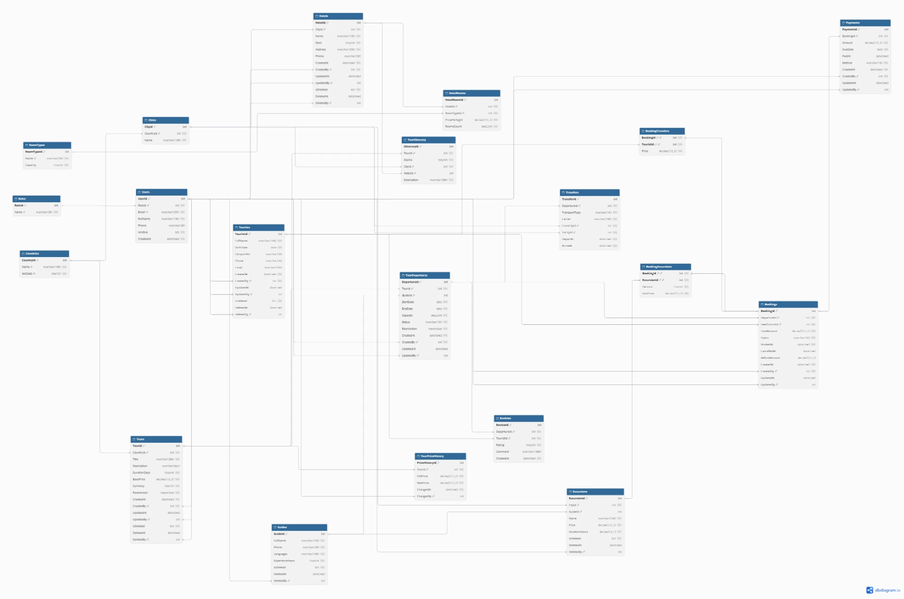

# TourismEcosystem

Tourism ecosystem: tours with itineraries, departures with guides and transfers, hotels, tourists, bookings, excursions, payments and reviews.

- **Lab 1** — relational database on MS SQL Server (20 tables, procedures, functions, triggers, views, indexes) and an ASP.NET Core Web API with the Repository + Unit of Work patterns. Report: [docs/lab1-report.md](docs/lab1-report.md).



## Tech stack

| | |
|---|---|
| DBMS | Microsoft SQL Server 2025 (LocalDB) |
| Application | .NET 10, ASP.NET Core Web API, Dapper, Swagger UI |
| Tests | xUnit (integration, on LocalDB), SQL checks in `sql/99_tests.sql` |

## Quick start

Requirements: Windows, .NET SDK 10, SQL Server LocalDB, `sqlcmd`.

```powershell
.\deploy.ps1 -Test                                                  # create the DB, load data, run 13 SQL checks
dotnet test                                                         # 6 Unit of Work integration tests
dotnet run --project src\TourismEcosystem.Api --launch-profile http
```

Swagger UI: http://localhost:5186/swagger. Write requests need the `X-User-Id` header (1–5, users from the test data).

## Structure

```
docs/
  lab1-report.md            Lab 1 report
  requirements.md           system requirements
  schema.dbml               ER schema for dbdiagram.io
  er-diagram.webp           ER diagram
sql/
  00–07                     database, schema, functions, views, procedures, triggers, indexes, data
  99_tests.sql              business logic checks
src/TourismEcosystem.Api/   Web API: Controllers, Data (Unit of Work, Repositories), Models
tests/TourismEcosystem.Tests/ integration tests
deploy.ps1                  database deployment
```

## Lab 1: assignment checklist

| Item | Implementation |
|---|---|
| 1. Database schema | [docs/er-diagram.webp](docs/er-diagram.webp), [docs/schema.dbml](docs/schema.dbml) |
| 2. ≥ 15 entities | 20 tables — [sql/01_schema.sql](sql/01_schema.sql) |
| 3. Requirements, soft delete, audit | [docs/requirements.md](docs/requirements.md); soft delete on 5 tables, `UpdatedAt/UpdatedBy` on 6 tables |
| 4. Implementation in a DBMS | MS SQL Server, scripts in [sql/](sql), [deploy.ps1](deploy.ps1) |
| 5. ≥ 10 server-side objects | 37: 7 functions, 8 views, 15 procedures, 7 triggers |
| 6. ≥ 2 index types | clustered, unique, filtered, composite + INCLUDE, columnstore — [sql/06_indexes.sql](sql/06_indexes.sql) |
| 7. Repository + Unit of Work | [src/TourismEcosystem.Api/Data](src/TourismEcosystem.Api/Data); demo — `POST /api/bookings` |

Details — in the [report](docs/lab1-report.md).
