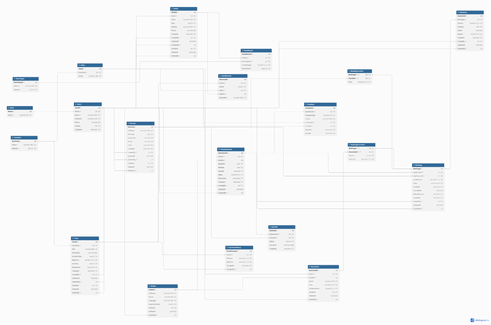

# Lab 1 Report

**Topic:** Tourism Ecosystem — design and implementation of a relational database, server-side logic, and data access from code via Repository + Unit of Work.

**Author:** Albina Kara
**DBMS:** Microsoft SQL Server 2025 (LocalDB)
**Code:** C# / .NET 10, ASP.NET Core Web API, Dapper

## Contents
1. [Domain and requirements](#1-domain-and-requirements)
2. [Database schema](#2-database-schema)
3. [Entities, soft delete and audit](#3-entities-soft-delete-and-audit)
4. [Implementation in the DBMS](#4-implementation-in-the-dbms)
5. [Stored procedures, functions, triggers, views](#5-stored-procedures-functions-triggers-views)
6. [Indexes](#6-indexes)
7. [Repository + Unit of Work](#7-repository--unit-of-work)
8. [Testing](#8-testing)
9. [Conclusions](#9-conclusions)

---

## 1. Domain and requirements

The system serves a tour operator: tours with day-by-day itineraries, scheduled departures with guides and transfers, partner hotels, tourists, bookings with optional excursions, payments and reviews.

**Roles:**
- **Admin** — manages reference data and users;
- **Manager** — manages tours, departures, hotels and guides, oversees payments and reports;
- **Agent** — registers tourists, creates bookings, accepts payments;
- **Tourist**, **Guide** — external parties.

**Key requirements:**
1. A tour has a destination country, duration, base price and an itinerary (city and hotel for each day).
2. A departure has dates, capacity, a guide and transfers; a guide cannot lead two overlapping departures.
3. Every tour price change goes to the price history automatically.
4. A booking is made for an open upcoming departure, has a lead tourist and several travelers; seats are limited by the capacity.
5. Children under 12 pay 50% of the tour price; excursions are added as price × persons; the booking total is recalculated automatically.
6. A booking is confirmed automatically once fully paid; overpayment is not allowed; overdue payments are tracked.
7. Cancellation refund depends on the days left before the start (100% / 50% / 25% / 0%); cancelled bookings free their seats.
8. A review is allowed only after the departure ended and only from a tourist who traveled on it.
9. Tourists, guides, hotels, tours and excursions are never physically deleted (soft delete); key entities store the date and the author of the last change.
10. The application accesses the database **only** through stored procedures (writes) and views / table-valued functions (reads).

Full description — [requirements.md](requirements.md).

## 2. Database schema

The ER diagram was built in [dbdiagram.io](https://dbdiagram.io) from [schema.dbml](schema.dbml) (paste it into dbdiagram.io for an interactive view).



**Relationship types:**

| Relationship | Type | Example |
|---|---|---|
| Bookings ↔ Tourists | M:N | via `BookingTravelers` with a composite PK and the traveler price |
| Bookings ↔ Excursions | M:N | via `BookingExcursions` with a composite PK, persons and unit price |
| Hotels ↔ RoomTypes | M:N | via `HotelRooms` (price per night, number of rooms), `UQ (HotelId, RoomTypeId)` |
| Countries → Cities → Hotels | 1:N (chain) | normalized geography |
| Tours → TourItinerary, Tours → TourDepartures, Tours → TourPriceHistory | 1:N | `UQ (TourId, DayNo)` in the itinerary |
| TourDepartures → Bookings, Transfers, Reviews; Bookings → Payments | 1:N | |
| Transfers → Cities | two 1:N | `FromCityId`, `ToCityId`, `CHECK (FromCityId <> ToCityId)` |
| Users → `CreatedBy / UpdatedBy / DeletedBy` columns | 1:N | author of a change in the audit columns |

All foreign keys have no cascading delete (`NO ACTION`): related data cannot be deleted physically, soft delete is used instead.

## 3. Entities, soft delete and audit

**20 tables** (the assignment requires at least 15):

| Group | Tables |
|---|---|
| Users | `Roles`, `Users` |
| Geography | `Countries`, `Cities` |
| Participants | `Tourists`, `Guides` |
| Accommodation | `Hotels`, `RoomTypes`, `HotelRooms` |
| Tours | `Tours`, `TourItinerary`, `TourDepartures`, `TourPriceHistory`, `Transfers` |
| Bookings | `Bookings`, `BookingTravelers`, `Payments` |
| Services and feedback | `Excursions`, `BookingExcursions`, `Reviews` |

**Soft delete** (`IsDeleted bit`, `DeletedAt`, `DeletedBy` → `Users`): `Tourists`, `Guides`, `Hotels`, `Tours`, `Excursions`.

**Change audit** (`CreatedAt`, `CreatedBy`, `UpdatedAt`, `UpdatedBy` → `Users`): `Tourists`, `Hotels`, `Tours`, `TourDepartures`, `Bookings`, `Payments`.

**Optimistic locking:** `Tours.RowVersion` and `TourDepartures.RowVersion` (`rowversion`) — the price-change and departure-update procedures reject the change if another user modified the row in the meantime.

**Pessimistic locking for seats:** `sp_Booking_Create` and `sp_Booking_AddTraveler` read the departure `WITH (UPDLOCK, HOLDLOCK)` inside a transaction, so two parallel bookings cannot take the last seat twice.

**Integrity constraints:** `CHECK` (prices > 0, stars and rating 1–5, `EndDate >= StartDate`, `ArriveAt > DepartAt`, allowed statuses, transport types and payment methods), `UNIQUE`, `DEFAULT`.

## 4. Implementation in the DBMS

The scripts in [`sql/`](../sql) run in order via [`deploy.ps1`](../deploy.ps1), which recreates the database from scratch:

| Script | Contents |
|---|---|
| `00_create_db.sql` | creates the `TourismEcosystemDb` database |
| `01_schema.sql` | 20 tables, PK, FK, CHECK, DEFAULT, UNIQUE |
| `02_functions.sql` | scalar functions |
| `03_views.sql` | views and table-valued functions |
| `04_procedures.sql` | stored procedures |
| `05_triggers.sql` | triggers |
| `06_indexes.sql` | indexes |
| `07_seed.sql` | test data (departures, bookings, payments and reviews go through procedures so the business rules and triggers fire) |
| `99_tests.sql` | automated business logic checks |

```powershell
.\deploy.ps1 -Test
```

## 5. Stored procedures, functions, triggers, views

**37 objects** in total (at least 10 required).

### Functions (7)

| Function | Kind | Purpose |
|---|---|---|
| `fn_CalcTravelerPrice(@BasePrice, @BirthDate, @OnDate)` | scalar | traveler price: 50% for children under 12 on the start date |
| `fn_CalcRefund(@PaidAmount, @StartDate, @CancelDate)` | scalar | refund by days before the start: 30+ — 100%, 14–29 — 50%, 7–13 — 25%, else 0 |
| `fn_GetAvailableSeats(@DepartureId)` | scalar | capacity minus travelers of non-cancelled bookings |
| `fn_CalcBookingTotal(@BookingId)` | scalar | sum of traveler prices and excursions (unit price × persons) |
| `fn_GetBookingDebt(@BookingId)` | scalar | booking total minus paid payments |
| `fn_DeparturesByCountry(@CountryId)` | table-valued (inline) | upcoming open departures in a country |
| `fn_DeparturesByGuide(@GuideId)` | table-valued (inline) | all departures of a guide |

### Views (8)

| View | Shows |
|---|---|
| `vw_ActiveTourists` | non-deleted tourists |
| `vw_ActiveTours` | non-deleted tours with country, average rating and review count |
| `vw_DepartureDetails` | all departures with tour, guide, free seats, price |
| `vw_UpcomingDepartures` | open future departures of active tours |
| `vw_BookingDetails` | bookings with tour, lead tourist, travelers count, paid amount and debt |
| `vw_PaymentsByBooking` | payments with the lead tourist and paid flag |
| `vw_OverduePayments` | unpaid payments of pending bookings past their due date |
| `vw_GuidePerformance` | guide metrics: departures, tourists served, average rating |

### Stored procedures (15)

| Procedure | What it does |
|---|---|
| `sp_Tourist_Create / Update` | create and update a tourist with audit; birth date in the future is rejected |
| `sp_Tourist_SoftDelete` | soft delete; not allowed while the tourist has an active booking |
| `sp_Tour_Create` | new tour |
| `sp_Tour_UpdatePrice` | price change with a `RowVersion` check |
| `sp_Tour_SoftDelete` | soft delete a tour and cancel its open departures; not allowed with active bookings |
| `sp_Departure_Create` | new departure: end date from the tour duration, the guide must be free on these dates |
| `sp_Departure_Update` | change guide and capacity with a `RowVersion` check; capacity cannot drop below booked seats |
| `sp_Booking_Create` | booking for an open future departure with the lead tourist as the first traveler, seat check under `UPDLOCK` |
| `sp_Booking_AddTraveler` | add a traveler with the calculated price; checks seats and duplicates |
| `sp_Booking_AddExcursion` | add an excursion; persons cannot exceed the number of travelers |
| `sp_Booking_Cancel` | cancel before the start, refund via `fn_CalcRefund` |
| `sp_Payment_Register` | payment or scheduled payment; overpaying the debt is not allowed |
| `sp_Payment_MarkPaid` | mark a scheduled payment as paid |
| `sp_Review_Add` | review only after the departure ended and only from its traveler, one per tourist |

Business rule violations are raised with `THROW` and codes: `50400` — invalid data, `50404` — not found, `50409` — state conflict. The Web API maps them to HTTP 400 / 404 / 409.

Procedures with several changes or locks (`sp_Tour_SoftDelete`, `sp_Booking_Create`, `sp_Booking_AddTraveler`, `sp_Booking_AddExcursion`, `sp_Booking_Cancel`) work both on their own and inside an application transaction: if a transaction is already open, they use `SAVE TRANSACTION`, so an error inside the procedure does not break the outer Unit of Work transaction.

### Triggers (7)

| Trigger | Event | Logic |
|---|---|---|
| `trg_Tours_PriceHistory` | AFTER UPDATE on `Tours` | on a price change, writes a row to `TourPriceHistory` (old/new price, author) |
| `trg_Tours_InsteadOfDelete` | INSTEAD OF DELETE on `Tours` | turns `DELETE` into a soft delete |
| `trg_Hotels_InsteadOfDelete` | INSTEAD OF DELETE on `Hotels` | turns `DELETE` into a soft delete |
| `trg_Tourists_InsteadOfDelete` | INSTEAD OF DELETE on `Tourists` | turns `DELETE` into a soft delete |
| `trg_BookingTravelers_Sync` | AFTER INSERT, UPDATE, DELETE on `BookingTravelers` | blocks overbooking even for direct inserts; recalculates the booking total |
| `trg_BookingExcursions_RecalcTotal` | AFTER INSERT, UPDATE, DELETE on `BookingExcursions` | recalculates the booking total |
| `trg_Payments_ConfirmBooking` | AFTER INSERT, UPDATE on `Payments` | a pending booking becomes `Confirmed` when the debt reaches zero |

The author of a plain `DELETE` is taken from `SESSION_CONTEXT(N'UserId')`.

## 6. Indexes

| Type | Index | Purpose |
|---|---|---|
| Clustered | PK of every table | physical row order by key |
| Unique nonclustered | `UX_Users_Email`, `UNIQUE` constraints (`Countries.IsoCode`, `Cities (CountryId, Name)`, `HotelRooms (HotelId, RoomTypeId)`, `Reviews (DepartureId, TouristId)`) | unique login and natural keys |
| Filtered unique | `UX_Tourists_Passport_Active … WHERE IsDeleted = 0 AND PassportNo IS NOT NULL` | a passport is unique only among non-deleted tourists; children without a passport are allowed |
| Filtered nonclustered + INCLUDE | `IX_Tours_Country_Active`, `IX_Hotels_City_Active` (`WHERE IsDeleted = 0`) | queries touch only active rows, the index is smaller |
| Composite + INCLUDE (covering) | `IX_TourDepartures_Status_StartDate (Status, StartDate) INCLUDE (TourId, GuideId, Capacity)` | search open departures by date range without touching the table |
| Nonclustered on FKs | 12 indexes (`IX_Bookings_Departure`, `IX_Payments_Booking`, `IX_TourDepartures_Guide`, etc.) | fast JOINs, FK checks, seat counting and guide overlap checks |
| Nonclustered columnstore | `NCCI_Payments (BookingId, Amount, DueDate, PaidAt, Method)` | aggregate payment reports |

Index usage is demonstrated at the end of `99_tests.sql` with `SET STATISTICS IO ON`: each of the three sample queries reads 2 pages.

## 7. Repository + Unit of Work

The logically related chain of entities: **Tourist → Booking → Travelers / Excursions → Payment**, plus **Tour → Departure**.

```
Controller ──> IUnitOfWork ──┬── ITouristRepository   ──> vw_ActiveTourists / sp_Tourist_*
                             ├── ITourRepository      ──> vw_ActiveTours / sp_Tour_*
                             ├── IDepartureRepository ──> vw_DepartureDetails, vw_UpcomingDepartures,
                             │                            fn_DeparturesByCountry, fn_DeparturesByGuide / sp_Departure_*
                             ├── IBookingRepository   ──> vw_BookingDetails / sp_Booking_*
                             └── IPaymentRepository   ──> vw_PaymentsByBooking, vw_OverduePayments / sp_Payment_*
                  one SqlConnection + one SqlTransaction shared by all repositories
```

- [`UnitOfWork.cs`](../src/TourismEcosystem.Api/Data/UnitOfWork.cs) opens one connection and provides `BeginTransaction / Commit / Rollback`; an uncommitted transaction is rolled back on `Dispose`.
- Repositories ([`Data/Repositories`](../src/TourismEcosystem.Api/Data/Repositories)) share the connection and the transaction of the UoW. **Reads** are only `SELECT`s from views / table-valued functions, **writes** are only `CommandType.StoredProcedure`. There are no direct queries to tables.
- The user for the audit columns is passed to every procedure as `@UserId` (in the API — from the `X-User-Id` header).

Demo — `POST /api/bookings` ([`BookingsController.cs`](../src/TourismEcosystem.Api/Controllers/BookingsController.cs)): new tourists, the booking, the other travelers, excursions and the first payment in one transaction.

```csharp
uow.BeginTransaction();
try
{
    foreach (var tourist in request.NewTourists ?? [])
        touristIds.Add(await uow.Tourists.CreateAsync(tourist, userId));

    var bookingId = await uow.Bookings.CreateAsync(request.DepartureId, touristIds[0], userId);
    foreach (var touristId in touristIds.Skip(1))
        await uow.Bookings.AddTravelerAsync(bookingId, touristId, userId);
    foreach (var excursion in request.Excursions ?? [])
        await uow.Bookings.AddExcursionAsync(bookingId, excursion.ExcursionId, excursion.Persons, userId);

    int? paymentId = request.Payment is { } payment
        ? await uow.Payments.RegisterAsync(bookingId, payment, userId)
        : null;
    uow.Commit();
    ...
}
catch
{
    uow.Rollback();
    throw;
}
```

If any step fails (no free seats, an overpayment, an unknown excursion), all writes are rolled back, including the new tourists.

Example request:

```json
{
  "departureId": 2,
  "touristIds": [6],
  "newTourists": [{ "fullName": "Child Traveler", "birthDate": "2018-03-01" }],
  "excursions": [{ "excursionId": 1, "persons": 2 }],
  "payment": { "amount": 1000, "dueDate": "2026-11-12", "paidAt": "2026-11-12T10:00:00", "method": "Card" }
}
```

Result: total 19,200 = 12,000 (adult) + 6,000 (child, 50%) + 2 × 600 (excursion), debt 18,200, status `Pending`.

**API endpoints** (Swagger: `http://localhost:5186/swagger`):

| Method | Path | Action |
|---|---|---|
| GET, POST | `/api/tourists`, `/api/tourists/{id}` | tourists |
| PUT, DELETE | `/api/tourists/{id}` | update, soft delete |
| GET, POST | `/api/tours`, `/api/tours/{id}` | active tours, new tour |
| PUT | `/api/tours/{id}/price` | price change (with `RowVersion`) |
| DELETE | `/api/tours/{id}` | soft delete |
| GET | `/api/departures`, `/api/departures?countryId=`, `/api/departures?guideId=`, `/api/departures/{id}` | departures |
| POST | `/api/tours/{id}/departures` | new departure |
| PUT | `/api/departures/{id}` | change guide and capacity (with `RowVersion`) |
| POST | `/api/bookings` | a booking with travelers, excursions and payment in one transaction |
| GET | `/api/bookings/{id}` | booking details |
| POST | `/api/bookings/{id}/travelers`, `/api/bookings/{id}/excursions` | add a traveler / excursion |
| POST | `/api/bookings/{id}/cancel` | cancel with refund |
| GET, POST | `/api/bookings/{id}/payments` | payments of a booking, new payment |
| GET | `/api/payments/overdue` | overdue payments |
| PUT | `/api/payments/{id}/paid` | mark paid |

## 8. Testing

**SQL checks** (`sql/99_tests.sql`, run inside a transaction with `ROLLBACK`, data is not changed) — 13/13 passed:

| # | What is checked |
|---|---|
| 1 | `DELETE` on Tours, Hotels, Tourists does not remove rows but soft deletes them (with `DeletedBy` from `SESSION_CONTEXT`); they disappear from the views |
| 2 | `trg_Tours_PriceHistory` records the price history with the author |
| 3 | the procedure fills `UpdatedAt / UpdatedBy` |
| 4 | `fn_CalcTravelerPrice` (age boundary 11/12), child discount and the booking total recalculated by triggers |
| 5 | fully paid bookings are `Confirmed` by the trigger; `fn_GetBookingDebt`, `vw_OverduePayments` |
| 6 | an overpayment is rejected with code 50400 |
| 7 | a stale `RowVersion` is rejected with 50409; capacity below booked seats is rejected |
| 8 | the last seat is taken, the next traveler is rejected with 50409 |
| 9 | cancellation refunds 100% 40 days before and 0% 5 days before, seats are freed; `fn_CalcRefund` 50% / 25% |
| 10 | reviews are rejected for a future departure and from a non-traveler |
| 11 | `fn_DeparturesByCountry`, `fn_DeparturesByGuide`, `vw_GuidePerformance` |
| 12 | a procedure error inside an outer transaction does not break it (savepoint) |
| 13 | a direct `INSERT` into `BookingTravelers` over the capacity is blocked by the trigger |

**Integration tests** (`tests/TourismEcosystem.Tests`, xUnit, `dotnet test`) — 6/6 passed:

| Test | What it checks |
|---|---|
| `Booking_Commit_SavesAllEntities` | tour, departure, two tourists, booking, excursion and payment are saved; total 16,200 with the child discount, the trigger confirms the booking, debt 0 |
| `Booking_FailsOnPayment_RollsBackEverything` | failure at the payment step → after `Rollback` there is no tourist, booking or departure in the database |
| `AddTraveler_OverCapacity_Throws409_AndKeepsTransaction` | overbooking is rejected, the transaction stays usable |
| `Cancel_RefundsPaidAmount_AndFreesSeats` | cancellation 35 days before refunds the full amount and frees the seat |
| `UpdatePrice_WithStaleRowVersion_Throws409` | optimistic locking |
| `SoftDelete_HidesTourist` | soft delete hides the tourist from the view |

**Manual API check:** `POST /api/bookings` → 201; a booking with an overpayment → 400 and the new tourist does not appear in the database; a request without `X-User-Id` → 400; cancelling a non-existent booking → 404; cancelling a booking of a past departure → 409.

## 9. Conclusions

1. A normalized schema of 20 tables was designed with 1:N and M:N relationships (three junction tables with their own attributes) and integrity constraints at the database level.
2. Soft delete is implemented on two levels: procedures (`sp_*_SoftDelete`) and `INSTEAD OF DELETE` triggers, so even a plain `DELETE` does not remove data. Change audit is filled by procedures and triggers.
3. Business rules (child discount, booking total, seat limit, automatic confirmation, refund policy, guide schedule, review eligibility, price history) run in the database and do not depend on the client.
4. Concurrency is handled with `rowversion` for edits and `UPDLOCK` for seats; the capacity trigger is a safety net for direct writes.
5. Several kinds of indexes are tailored to specific queries; filtered indexes work together with soft delete.
6. Repository + Unit of Work provides atomic operations over several entities: all queries from code go through procedures and views, and several procedures run in one transaction with a full rollback on error.
